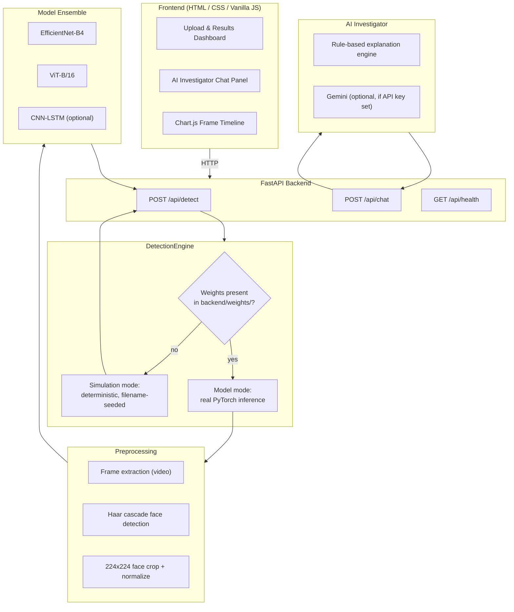

<h1 align="center">🛡️ DeepFake Sentinel</h1>
<h3 align="center">Multi-Model Deepfake Detection Platform</h3>

<p align="center">
  
  
  
  
</p>

<p align="center">
  <a href="#overview">Overview</a> •
  <a href="#system-architecture">Architecture</a> •
  <a href="#quick-start">Quick Start</a> •
  <a href="#models--training">Models &amp; Training</a> •
  <a href="#results">Results</a> •
  <a href="#api-reference">API</a> •
  <a href="study_guide.md">Study Guide</a>
</p>

---

## Overview

DeepFake Sentinel is a deepfake detection platform built around a three-model ensemble — **EfficientNet-B4**, **Vision Transformer (ViT-B/16)**, and a **CNN-LSTM** temporal network — exposed through a FastAPI backend with a browser-based dashboard and a rule-based "AI Investigator" agent that explains each verdict in plain language.

The project was built to demonstrate the full lifecycle of an applied ML system end to end: data sourcing, model training on real datasets, an inference engine with a graceful fallback path, a REST API with proper error handling, a frontend that consumes that API correctly, and an explainability layer on top. It is **not** a state-of-the-art deepfake detector and does not claim benchmark numbers it hasn't actually measured — see [Results](#results) for exactly what was trained, on what data, and how well it performs.

**What's real vs. what's a fallback:**

| Component | Status |
|---|---|
| EfficientNet-B4 | Trained on a real-vs-AI-generated face dataset (140k Real and Fake Faces). See metrics below. |
| ViT-B/16 | Trained on the same dataset, same run. |
| CNN-LSTM | Architecturally complete and integrated, but trained on a 10-clip demonstration set — **not production-grade**. See caveats below. |
| Detection engine | Runs in `model` mode automatically once weight files are present in `backend/weights/`; falls back to a deterministic `simulation` mode otherwise so the API/UI can be demoed without any weights at all. |
| AI Investigator agent | Rule-based by default (no LLM needed to run); optionally upgrades to Gemini if a `GEMINI_API_KEY` is set. |

---

## System Architecture



The key design decision is the **mode switch inside `DetectionEngine`**: the same API contract is returned whether real weights are loaded or not, so the frontend never needs to know which mode it's in. This was deliberate — it means the project is runnable and demoable immediately after cloning (simulation mode, zero setup), and upgrades to real inference the moment trained weights are dropped into `backend/weights/`, with no code changes.

---

## Quick Start

### Prerequisites

- Python 3.9+
- ~5GB free disk space if you want to run with real model weights (PyTorch + torchvision + the three checkpoints)
- A GPU is **not** required — the platform runs on CPU (inference is just slower per request)

### Installation

```bash
git clone https://github.com/yourusername/deepfake-detection-platform.git
cd deepfake-detection-platform

python -m venv venv
# Windows
venv\Scripts\activate
# macOS/Linux
source venv/bin/activate

pip install -r backend/requirements.txt
```

### Running (simulation mode — works immediately, no weights needed)

```bash
python run.py
```

Open `http://127.0.0.1:8000`. Upload any image/video; the engine will run in `simulation` mode (deterministic, filename-seeded mock predictions) and the UI/API will behave identically to model mode in terms of response shape. Check `http://127.0.0.1:8000/api/health` — it will report `"engine_mode": "simulation"`.

### Running with real trained weights

1. Download the trained weights (see [Models & Training](#models--training) for how they were produced, or train your own with the provided Colab notebooks in `training/`).
2. Place them in `backend/weights/`:
   ```
   backend/weights/
   ├── efficientnet_b4.pt
   ├── vit_base.pt
   └── cnn_lstm.pt   (optional — see caveats)
   ```
3. Restart `python run.py`. The startup log will show:
   ```
   DetectionEngine running in MODEL mode on device=cpu
   ```
4. `/api/health` will now report `"engine_mode": "model"`.

> **Note on weight files:** trained weights are not committed to this repository (`*.pt` is in `.gitignore`) — `vit_base.pt` alone is ~340MB, well over GitHub's 100MB file size limit for a normal push, and committing large binaries bloats clone time for anyone visiting the repo. See [Obtaining the weights](#obtaining-the-weights) below.

---

## Models & Training

All three models share the same PyTorch architecture definitions in `backend/models/`, with factory functions (`create_efficientnet`, `create_vit`, `create_cnn_lstm`) so the same code path is used whether weights are randomly initialized, loaded from a checkpoint, or used purely for parameter counting.

### EfficientNet-B4

A `timm`-based EfficientNet-B4 backbone with the classification head replaced by a 2-class (real/fake) linear layer. EfficientNet's compound scaling and squeeze-and-excitation blocks make it sensitive to local texture artifacts — blending boundaries, compression inconsistencies, and unnatural skin smoothing typical of GAN-generated faces.

### Vision Transformer (ViT-B/16)

A `timm`-based ViT-B/16, pretrained on ImageNet, fine-tuned with a custom LayerNorm → Dropout → Linear head. ViT's global self-attention lets it pick up on structural inconsistencies that span non-local regions of a face — something a purely convolutional model can miss.

### CNN-LSTM

A ResNet-18 frame-feature extractor feeding a 2-layer bidirectional LSTM with additive temporal attention, intended to catch frame-to-frame flickering and jitter in video deepfakes. **This model's weights were produced from a 10-clip dataset** (5 real, 5 face-swap/lip-sync deepfake samples from the public `UniDataPro/deepfake-videos-dataset`) purely to validate that the full training → export → load pipeline works end to end. It is not trained on enough data to generalize reliably — see [Results](#results) for the honest numbers, and [Future Work](#future-work) for what a real version of this would need.

### Training data

| Model | Dataset | Size used | What it teaches the model |
|---|---|---|---|
| EfficientNet-B4 | [140k Real and Fake Faces](https://www.kaggle.com/datasets/xhlulu/140k-real-and-fake-faces) (Kaggle) — real FFHQ photos vs. StyleGAN-generated faces | 10% subset (~10k train / ~4k valid) | Spatial/texture cues distinguishing real photos from GAN-generated faces |
| ViT-B/16 | Same dataset, same run | Same subset | Same task, different inductive bias (global attention vs. local convolution) |
| CNN-LSTM | [UniDataPro/deepfake-videos-dataset](https://huggingface.co/datasets/UniDataPro/deepfake-videos-dataset) (Hugging Face) — real webcam clips vs. face-swap/lip-sync deepfakes | 10 clips total (8 train / 2 valid) | Demonstration of the training pipeline; not enough data for reliable generalization |

Training was done in Google Colab on a T4 GPU. Notebooks are provided in `training/` so the entire process is reproducible:
- `training/phase1_train_efficientnet_vit.ipynb`
- `training/phase2_train_cnn_lstm.ipynb`

### Obtaining the weights

Two options:

1. **Train your own** — run the notebooks in `training/` in Colab (free tier works). EfficientNet+ViT takes roughly 30-60 minutes; CNN-LSTM trains in under a minute given how small its dataset is. Drop the resulting `.pt` files into `backend/weights/` as shown above.

2. **Download from a GitHub Release** — if you've published a release with the `.pt` files attached as release assets (see below), run:
   ```bash
   python download_weights.py
   ```
   This pulls `efficientnet_b4.pt`, `vit_base.pt`, and `cnn_lstm.pt` from the release tag configured at the top of that script.

#### Publishing your own weights as a release (so others — or you, on a fresh clone — can use `download_weights.py`)

Trained weights aren't committed directly to the repo: `vit_base.pt` is ~340MB, over GitHub's 100MB-per-file limit for a normal `git push`, and even Git LFS would add unnecessary clone weight for anyone just browsing the code. GitHub Releases support attachments up to 2GB each and don't bloat the repository itself, which is why this project uses that instead of LFS.

```bash
# 1. Tag a release (match RELEASE_TAG in download_weights.py)
git tag v1.0-weights
git push origin v1.0-weights

# 2. On GitHub: go to Releases -> Draft a new release -> select the tag you just pushed
#    -> attach efficientnet_b4.pt, vit_base.pt, cnn_lstm.pt as binary assets -> Publish

# 3. Update GITHUB_REPO in download_weights.py to your actual repo path
```

After that, anyone (including a fresh `git clone` of your own repo on a different machine) can run `python download_weights.py` instead of re-training from scratch.

---

## Results

These are the actual validation metrics from the training runs in this repository's notebooks — not estimates, not benchmark-paper numbers.

| Model | Dataset | Validation Accuracy | Notes |
|---|---|---|---|
| EfficientNet-B4 | 140k Real/Fake Faces (10% subset, 3 epochs) | **95.4%** | Strong, consistent with the dataset being a relatively clean, single-source GAN-vs-real split |
| ViT-B/16 | 140k Real/Fake Faces (10% subset, 3 epochs) | **99.2%** | Notably more decisive than EfficientNet on this dataset |
| CNN-LSTM | 10-clip demonstration set (15 epochs, frozen backbone) | Highly variable (0–100% across epochs, 2-sample validation set) | **Not a reliable metric** — too few validation samples for the number to mean anything statistically. Included for transparency. |

**Honest caveats:**

- The 140k Real/Fake Faces dataset is StyleGAN-vs-FFHQ at a fairly consistent resolution and style. These numbers say the models are good at separating *this specific distribution* — they have not been validated against diffusion-generated faces, compressed social-media images, non-frontal poses, or other GAN architectures. Real-world generalization is untested.
- CNN-LSTM's "metrics" above are not meaningful in the statistical sense (a 2-sample validation split can only ever report 0%, 50%, or 100%). It is included in the ensemble to demonstrate the complete architecture and pipeline, not because its predictions should be trusted standalone. The `DetectionEngine` approximates a temporal score from EfficientNet+ViT when `cnn_lstm.pt` isn't present, which is arguably more reliable than the under-trained CNN-LSTM checkpoint itself.
- No model in this project has been evaluated against FaceForensics++, Celeb-DF, or DFDC test splits. Any future README claiming such numbers should come with the actual evaluation script and run logs.

---

## API Reference

| Endpoint | Method | Description |
|---|---|---|
| `/api/detect` | `POST` | Upload an image/video (`multipart/form-data`, field name `file`). Returns verdict, confidence, per-model scores, frame-by-frame analysis, and metadata. |
| `/api/chat` | `POST` | `{ "message": string, "context": <detect response> }` — ask the AI Investigator about the last analysis. |
| `/api/health` | `GET` | Returns `engine_mode` (`model`/`simulation`), `device`, `agent_mode`, upload limits, and allowed file extensions. |

Full request/response shapes are documented in `backend/detection_engine.py` and `backend/main.py` docstrings.

---

## Project Structure

```
deepfake-detection-platform/
├── README.md
├── study_guide.md
├── run.py
├── download_weights.py        # Fetches trained .pt files from a GitHub Release
├── .gitignore
├── LICENSE
│
├── backend/
│   ├── main.py                # FastAPI app, routes, upload handling
│   ├── detection_engine.py    # Model loading + inference + simulation fallback
│   ├── agent.py                # Rule-based / Gemini AI Investigator
│   ├── preprocess.py           # Frame extraction, face detection, cropping
│   ├── requirements.txt
│   ├── uploads/                 # Temporary upload storage (cleared per-request)
│   ├── weights/                 # Trained .pt files go here (not committed)
│   └── models/
│       ├── efficientnet.py
│       ├── vit.py
│       ├── cnn_lstm.py
│       └── ensemble.py          # Weighted ensemble fusion (currently unused by detection_engine; see Future Work)
│
├── frontend/
│   ├── index.html
│   ├── app.js
│   ├── style.css
│   └── assets/
│
└── training/
    ├── phase1_train_efficientnet_vit.ipynb
    └── phase2_train_cnn_lstm.ipynb
```

---

## Future Work

Listed honestly as things that would meaningfully improve this project, not as a marketing roadmap:

- **Real video dataset for CNN-LSTM** — FaceForensics++ or Celeb-DF access (both require a free academic access request with a multi-day approval wait) would let CNN-LSTM be trained on hundreds of labeled clips instead of 10, making its contribution to the ensemble actually meaningful rather than noise.
- **Cross-dataset evaluation** — testing the trained EfficientNet/ViT models against a *different* fake-face dataset (e.g. diffusion-generated faces rather than StyleGAN) to measure real generalization, not just same-distribution validation accuracy.
- **Wire up `ensemble.py`** — `backend/models/ensemble.py` implements a learnable weighted-fusion + temperature-calibration module that isn't currently used by `detection_engine.py` (which does simple averaging). Training the fusion weights on a held-out set would be a natural next step.
- **Face detection upgrade** — currently uses OpenCV Haar cascades (fast, dependency-light, but less accurate on non-frontal faces than MTCNN/RetinaFace).
- **GPU inference path** — currently CPU-only in the reference deployment; the code already detects CUDA if available, but hasn't been tested/benchmarked on a GPU.

---

## License

MIT License — see [LICENSE](LICENSE).

---

## Author

**Rishi Singh**
