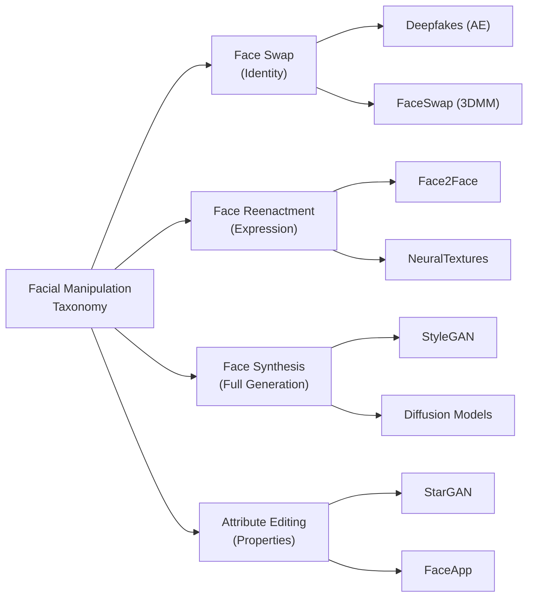
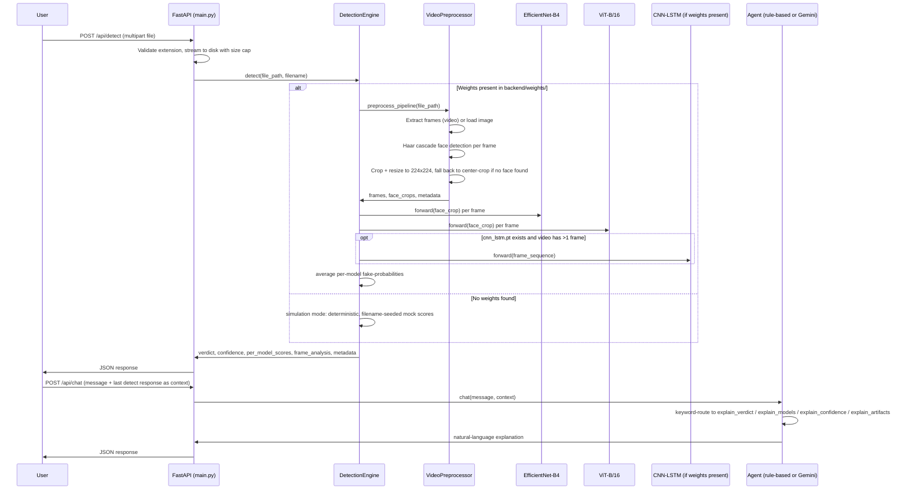

# 📚 DeepFake Sentinel — Comprehensive Study Guide

> **A deep dive into the theory, architecture, and implementation of modern deepfake detection systems.**

---

## Table of Contents

1. [Executive Summary](#executive-summary)
2. [Chapter 1: Introduction to Deepfakes](#chapter-1-introduction-to-deepfakes)
3. [Chapter 2: Datasets Deep Dive](#chapter-2-datasets-deep-dive)
4. [Chapter 3: Detection Model Architectures](#chapter-3-detection-model-architectures)
5. [Chapter 4: System Architecture Explained](#chapter-4-system-architecture-explained)
6. [Chapter 5: How It's Built — Technical Implementation](#chapter-5-how-its-built--technical-implementation)
7. [Chapter 6: Why It's Built — Motivation & Impact](#chapter-6-why-its-built--motivation--impact)
8. [Chapter 7: Future Prospects](#chapter-7-future-prospects)
9. [References](#references)

---

## Executive Summary

The proliferation of AI-generated synthetic media — commonly known as *deepfakes* — represents one of the most significant challenges to information integrity in the digital age. As generative models become increasingly accessible and their outputs more visually convincing, the demand for robust, real-time detection systems has never been greater. This study guide accompanies the **DeepFake Sentinel** platform, providing a rigorous academic treatment of the deepfake detection landscape: from the generative techniques used to create manipulated media, through the benchmark datasets that define the field, to the state-of-the-art detection architectures we employ.

DeepFake Sentinel integrates three architecturally complementary deep learning models — **EfficientNet-B4** for local texture and compression artifact analysis, **Vision Transformer (ViT-B/16)** for global structural consistency reasoning, and a **CNN-LSTM** hybrid for temporal coherence modeling across video frames. EfficientNet-B4 and ViT-B/16 were trained and validated on a real-vs-AI-generated face image dataset, reaching 95.4% and 99.2% validation accuracy respectively; CNN-LSTM was trained on a small 10-clip demonstration set primarily to prove out the training-to-deployment pipeline rather than to achieve production-grade accuracy. Exact numbers, datasets, and honest caveats are in Chapter 5 and the project [README](README.md#results) — this guide does not repeat unverified benchmark figures from the wider literature as if they were this project's own results. This guide is designed for researchers, engineers, and students seeking to understand both the *what* and the *why* behind modern deepfake detection, using this project as a worked example.

---

## Chapter 1: Introduction to Deepfakes

### 1.1 What Are Deepfakes?

The term "deepfake" is a portmanteau of "deep learning" and "fake," originally coined on a Reddit forum in late 2017 where a user by that pseudonym shared AI-generated face-swapped videos. In the broadest sense, a deepfake is any piece of synthetic media — image, video, or audio — produced or manipulated by deep learning algorithms to convincingly depict events that never occurred. While the underlying techniques (generative adversarial networks, autoencoders, diffusion models) have legitimate applications in entertainment, accessibility, and creative arts, their potential for malicious misuse has elevated deepfakes into a critical societal concern.

The rapid democratization of deepfake creation tools is particularly alarming. What once required expertise in computer vision and access to GPU clusters can now be accomplished through user-friendly applications like DeepFaceLab, FaceApp, and web-based services. As of 2025, estimates suggest that over 500,000 deepfake videos circulate on social media platforms, with the volume doubling approximately every six months (Sensity AI, 2024).

### 1.2 A Brief History

| Year | Milestone |
|---|---|
| 2014 | Goodfellow et al. introduce Generative Adversarial Networks (GANs) |
| 2017 | "Deepfakes" Reddit user publishes face-swap code using autoencoders |
| 2018 | FaceSwap and DeepFaceLab open-source projects gain traction |
| 2019 | FaceForensics++ benchmark released (Rössler et al., ICCV 2019) |
| 2019 | Facebook / Microsoft / Partnership on AI launch the Deepfake Detection Challenge (DFDC) |
| 2020 | Celeb-DF v2 raises the bar for synthesis quality (Li et al., CVPR 2020) |
| 2021 | First-generation diffusion models begin producing photorealistic faces |
| 2023 | Real-time deepfake video calls demonstrated with consumer hardware |
| 2024–25 | Multi-modal deepfakes (audio + video) and AI-generated "digital humans" emerge |

### 1.3 Types of Facial Manipulation

Understanding the taxonomy of facial manipulations is essential for designing effective detection systems, as each manipulation type leaves distinct forensic traces.

#### 1.3.1 Face Swap (Identity Replacement)

Face swap methods replace the **identity** of a source face with that of a target while preserving the original expression, pose, and lighting. Classical approaches use 3D Morphable Models (3DMMs) for geometric alignment followed by Poisson blending, while deep learning methods (e.g., the original deepfakes autoencoder) learn an identity-agnostic latent space shared between source and target. Telltale artifacts include **blending boundary inconsistencies**, **skin tone mismatch** at the face–hair boundary, and **resolution discrepancies** between the swapped face region and the background.

#### 1.3.2 Face Reenactment (Expression Transfer)

Face reenactment transfers the **expression and pose** from a driving video to a source identity, while preserving the source's appearance. Face2Face (Thies et al., 2016) pioneered real-time reenactment using dense 3D face reconstruction and image-based rendering. More recent methods like First Order Motion Model (Siarohin et al., 2019) operate without explicit 3D models, using learned keypoint representations. Forensic signatures include **unnatural mouth interior rendering**, **temporal inconsistencies in eye blink patterns**, and **geometric distortions** around the jaw and forehead boundary.

#### 1.3.3 Face Synthesis (Entire Generation)

Face synthesis methods generate **entirely new faces** that do not correspond to any real person. StyleGAN (Karras et al., 2019) and its successors produce remarkably photorealistic faces, but exhibit systematic artifacts: **spectral irregularities** in the frequency domain, **asymmetric accessories** (earrings, glasses), and characteristic **texture patterns** in hair and background regions. More recently, diffusion models (DDPM, Stable Diffusion) have become the dominant paradigm, producing faces with fewer of the GAN-specific spectral artifacts but introducing their own forensic signatures.

#### 1.3.4 Face Attribute Manipulation

Attribute manipulation modifies specific facial properties — age, gender, hair color, skin tone — while keeping identity and expression largely intact. Methods like StarGAN and AttGAN perform targeted edits via conditional image translation. These manipulations are often the most challenging to detect because the modifications are subtle and localized.



---

## Chapter 2: Datasets Deep Dive

High-quality benchmark datasets are the foundation upon which deepfake detection research is built. The choice of training and evaluation data directly impacts a model's real-world detection capability, its robustness to compression, and its generalization across manipulation methods.

> **Note on this project's actual datasets:** FaceForensics++ and Celeb-DF, described below, are the standard academic benchmarks for video-based deepfake detection and are discussed here for context — **this project's models were not trained or evaluated on either of them.** EfficientNet-B4 and ViT-B/16 were trained on the *140k Real and Fake Faces* dataset (real FFHQ photos vs. StyleGAN-generated faces), and CNN-LSTM on a 10-clip sample from `UniDataPro/deepfake-videos-dataset`. See Chapter 5 for what was actually used and why, and the [README](README.md#models--training) for exact figures. Both FF++ and Celeb-DF require a multi-day academic access request that wasn't completed within this project's timeline — see Chapter 7 for that as a concrete next step.

### 2.1 FaceForensics++ (FF++)

**FaceForensics++** (Rössler et al., ICCV 2019) is the most widely adopted benchmark in the deepfake detection literature. It provides a controlled, systematic evaluation framework that isolates the effects of manipulation method and compression quality.

**Dataset Construction:**
- **Source Material:** 1,000 videos downloaded from YouTube, selected to contain predominantly frontal faces with limited occlusion. The videos span diverse demographics, lighting conditions, and background complexities.
- **Manipulation Pipeline:** Each of the 1,000 original videos was manipulated using four distinct methods, yielding 4,000 fake videos plus the 1,000 originals (5,000 total).
- **Compression:** All videos are provided at three quality levels to simulate real-world distribution conditions.

#### Manipulation Methods

| Method | Type | Technique | Key Artifacts |
|---|---|---|---|
| **Deepfakes** | Face Swap | Autoencoder-based identity swap | Blending boundaries, warping artifacts, resolution mismatch |
| **Face2Face** | Reenactment | 3D model-based expression transfer | Mouth interior, temporal jitter, geometric distortion |
| **FaceSwap** | Face Swap | 3DMM fitting + Poisson blending | Color bleeding, illumination mismatch, hard boundaries |
| **NeuralTextures** | Reenactment | Neural rendering with learned textures | Minimal spatial artifacts, subtle texture inconsistencies |

#### Compression Levels

| Level | Codec | Quantization | Simulates | Detection Difficulty |
|---|---|---|---|---|
| **c0 (Raw)** | None | Lossless | Lab conditions | Easiest — all artifacts preserved |
| **c23 (HQ)** | H.264 | QP=23 | High-quality social media | Moderate — standard benchmark |
| **c40 (LQ)** | H.264 | QP=40 | Heavy compression / re-encoding | Hardest — artifacts partially destroyed |

**Why c23 is the Standard Benchmark:** Raw video (c0) is unrealistically pristine — real-world media is virtually always compressed. Heavy compression (c40) destroys both manipulation artifacts *and* legitimate facial details, making detection nearly impossible for any method. The c23 level strikes a pragmatic balance: it introduces realistic compression artifacts while preserving sufficient forensic signal for meaningful detection. Nearly all published results report on c23, making it the de facto standard for cross-method comparison.

**Official Split:** 720 videos for training, 140 for validation, 140 for testing, applied consistently across all manipulation types.

### 2.2 Celeb-DF (v2)

**Celeb-DF version 2** (Li et al., CVPR 2020) was specifically designed to address the limitations of earlier datasets by producing **higher visual quality** forgeries that challenge existing detectors.

**Dataset Construction:**
- **Source Material:** 590 real videos of 59 celebrities sourced from YouTube interviews, spanning diverse ages, ethnicities, and genders.
- **Synthesis Method:** An improved deepfake synthesis algorithm that reduces visible artifacts through: (1) a refined face segmentation mask with feathered boundaries, (2) color transfer to match skin tones, (3) a trained neural network for edge blending, and (4) temporal smoothing across frames.
- **Fake Videos:** 5,639 deepfake videos generated by swapping faces among the 59 subjects.

**Key Differentiators from FF++:**
- Forgeries are **visually harder to distinguish** — even human evaluators achieve lower accuracy on Celeb-DF compared to FF++.
- Reduced blending boundaries eliminate the most obvious spatial artifact that detectors exploit.
- Greater diversity in subject demographics and video conditions.
- Primarily used for **cross-dataset evaluation**: models trained on FF++ are tested on Celeb-DF to assess generalization.

### 2.3 Comparative Overview of Major Datasets

| Dataset | Year | Real Videos | Fake Videos | Methods | Compression | Primary Use |
|---|---|---|---|---|---|---|
| FaceForensics++ | 2019 | 1,000 | 4,000 | 4 | c0/c23/c40 | Primary benchmark |
| Celeb-DF v2 | 2020 | 590 | 5,639 | 1 (improved) | YouTube | Cross-dataset eval |
| DFDC | 2020 | 23,654 | 104,500 | 8 | Variable | Scale & diversity |
| DeeperForensics-1.0 | 2020 | 10,000 | 50,000 | 1 | 7 distortions | Real-world robustness |
| WildDeepfake | 2020 | 3,805 | 3,509 | Various | In-the-wild | Unconstrained settings |
| ForgeryNet | 2021 | 99,630 | 121,617 | 15 | Variable | Largest-scale benchmark |

---

## Chapter 3: Detection Model Architectures

### 3.1 EfficientNet-B4: Compound-Scaled CNN

**Theoretical Foundation:**
EfficientNet (Tan & Le, ICML 2019) introduced the principle of **compound scaling** — the insight that scaling network depth, width, and input resolution together using a fixed ratio produces better accuracy-efficiency trade-offs than scaling any single dimension independently. The scaling is governed by a compound coefficient φ:

```
depth:      d = α^φ
width:      w = β^φ  
resolution: r = γ^φ

subject to: α · β² · γ² ≈ 2  (FLOPS constraint)
```

For EfficientNet-B4 (φ=4): α=1.2, β=1.1, γ=1.15, yielding depth scaling of 1.8×, width scaling of 1.4×, and resolution scaling to 380×380 in the original paper's configuration. **In this project**, EfficientNet-B4 is fed 224×224 face crops — the same size as ViT-B/16 — so that a single shared preprocessing pipeline (`VideoPreprocessor` in `backend/preprocess.py`) can serve both models without maintaining two separate crop/resize paths. This sacrifices some of EfficientNet-B4's native resolution advantage for implementation simplicity, a deliberate trade-off worth knowing about rather than discovering by reading the code.

**Architecture Components:**

1. **MBConv Blocks (Mobile Inverted Bottleneck):** The core building block uses depthwise separable convolutions with inverted residuals — expanding the channel dimension with a 1×1 convolution, applying a depthwise 3×3 or 5×5 convolution, then projecting back to a narrow bottleneck. This dramatically reduces parameter count while maintaining representational capacity.

2. **Squeeze-and-Excitation (SE) Attention:** Each MBConv block includes an SE module that performs global average pooling, passes the result through a two-layer FC bottleneck, and produces per-channel attention weights via sigmoid activation. In the context of deepfake detection, SE attention enables the network to **dynamically emphasize channels** that respond to compression artifacts, blending boundaries, and texture inconsistencies.

3. **Stochastic Depth:** During training, entire MBConv blocks are randomly dropped with linearly increasing probability, acting as a powerful regularizer that prevents overfitting on the relatively small FF++ dataset.

**Why EfficientNet-B4 for Deepfake Detection:**
- SE attention learns to upweight channels that fire on forensically relevant features such as compression artifacts and blending boundaries, in principle.
- At 19.3M parameters, it offers a reasonable accuracy/efficiency trade-off compared to deeper backbones.
- Strong transfer learning from ImageNet pre-training provides robust low-level feature representations, which is why this project initializes it with `pretrained=True` rather than training from scratch.
- **Observed result in this project:** 95.4% validation accuracy on the 140k Real/Fake Faces subset after 3 epochs of fine-tuning — strong, though notably lower than ViT-B/16's 99.2% on the identical split (see 3.2 for discussion).

### 3.2 Vision Transformer (ViT-B/16): Global Self-Attention

**Theoretical Foundation:**
The Vision Transformer (Dosovitskiy et al., ICLR 2021) demonstrated that pure transformer architectures, originally designed for NLP, can achieve state-of-the-art image classification when trained on sufficient data. Unlike CNNs, which build hierarchical local representations through spatially constrained convolution kernels, ViT processes images as **sequences of patches**, enabling each patch to attend to every other patch from the very first layer.

**Architecture Details:**

1. **Patch Embedding:** The input image (224×224×3) is divided into a grid of non-overlapping 16×16 patches, yielding 196 patches (14×14 grid). Each patch is linearly projected into a 768-dimensional embedding vector via a learnable projection matrix, effectively treating each patch as a "visual word."

2. **Positional Encoding:** Since self-attention is permutation-invariant, learnable 1D position embeddings are added to encode spatial structure. The model learns that patch 0 is the top-left corner and patch 195 is the bottom-right, enabling it to reason about spatial relationships.

3. **[CLS] Token:** A special learnable classification token is prepended to the patch sequence. After processing through all transformer layers, the [CLS] token's final representation serves as the aggregate image representation for classification.

4. **Multi-Head Self-Attention (MSA):** Each transformer layer computes:

```
Attention(Q, K, V) = softmax(QK^T / √d_k) · V

where Q = XW_Q, K = XW_K, V = XW_V
```

With 12 attention heads, the model learns 12 different attention patterns simultaneously — some heads may specialize in local texture analysis while others capture long-range structural relationships.

5. **Feed-Forward Network (MLP):** A two-layer MLP with GELU activation and hidden dimension 3072 (4× the embedding dim) follows each MSA block, providing non-linear transformation capacity.

**Why ViT for Deepfake Detection:**
- **Global receptive field from layer 1:** Unlike CNNs that require deep stacking to achieve large receptive fields, ViT can compare patches across the entire face in a single attention operation. This is crucial for detecting **global inconsistencies** — mismatched lighting direction between left and right face halves, asymmetric skin texture, or inconsistent shadow patterns.
- **Attention visualization:** The attention maps from ViT heads can in principle provide interpretable evidence of which facial regions the model considers most informative (the `ViTDetector` class in this project exposes attention-rollout hooks for this purpose, via `enable_attention_hooks()`), though the current frontend does not yet render these maps — see Chapter 7.
- **Robustness to local perturbations:** ViT's holistic processing makes it less susceptible to adversarial patches and local perturbations compared to purely convolutional approaches, in principle — this hasn't been specifically tested in this project.
- **Observed result in this project:** on the 140k Real/Fake Faces validation subset, ViT-B/16 reached 99.2% accuracy, notably higher than EfficientNet-B4's 95.4% on the same data and split — consistent with ViT's global attention being well-suited to the relatively uniform, frontal-face style of this particular dataset. This is a single-dataset observation, not a generalizable claim about ViT vs. CNN architectures.

### 3.3 CNN-LSTM: Temporal Consistency Modeling

**Motivation:**
Deepfake generation typically operates on a **per-frame** basis — each frame is independently synthesized and then re-composited into the video sequence. This frame-independent processing introduces temporal inconsistencies that are invisible in any single frame but become apparent when analyzing the video as a time series. The CNN-LSTM architecture is specifically designed to capture these inter-frame artifacts.

**Architecture Pipeline:**

1. **Spatial Feature Extraction (CNN):** A pre-trained ResNet-18 backbone extracts a 512-dimensional feature vector from each frame. The CNN is either frozen (for computational efficiency) or fine-tuned end-to-end (for maximum accuracy). We use ResNet-18 rather than a deeper backbone because the LSTM handles the discriminative reasoning — the CNN need only provide a rich spatial summary.

2. **Temporal Frame Sampling:** From each video, T=16 frames are sampled at uniform intervals, ensuring coverage of the full temporal extent while maintaining computational feasibility. For longer videos, a sliding window approach with stride=8 produces overlapping clips whose predictions are averaged.

3. **Bidirectional LSTM:** The sequence of 16 feature vectors is processed by a 2-layer bidirectional LSTM with hidden dimension 256. Bidirectionality allows the model to condition each frame's representation on both past and future context, capturing both forward and backward temporal patterns.

4. **Temporal Attention Pooling:** Rather than using only the final LSTM hidden state, we apply a learnable attention mechanism over the LSTM outputs to produce a weighted summary, allowing the model to focus on the most informative frames (e.g., those with visible flickering or boundary jitter).

**Temporal Artifacts Detected:**
- **Face boundary flickering:** The blending mask in per-frame deepfakes varies slightly between frames, causing visible jitter at the face boundary.
- **Inconsistent head pose dynamics:** Natural head motion follows smooth biomechanical trajectories; deepfake synthesis can introduce subtle jerks and discontinuities.
- **Eye blink anomalies:** Early deepfake methods failed to properly model eye blinks, though modern methods have partially addressed this.
- **Lighting temporal coherence:** Frame-by-frame synthesis can produce inconsistent lighting/shadow patterns across the sequence.

### 3.4 Why Ensemble Detection Works (In Theory) — and How This Project Actually Combines Models

Each of the three models is intended to capture a different class of forensic evidence:

| Model | Signal Type | Strengths | Weaknesses |
|---|---|---|---|
| EfficientNet-B4 | Local texture | Compression artifacts, blending boundaries | Misses global inconsistencies |
| ViT-B/16 | Global structure | Lighting, geometry, cross-face consistency | Less sensitive to pixel-level artifacts |
| CNN-LSTM | Temporal dynamics | Inter-frame jitter, motion anomalies | Requires multiple frames; image-only media gets an approximated score instead |

**What this project actually does:** `backend/models/ensemble.py` implements a proper `WeightedEnsemble` module with *learnable* softmax-normalized fusion weights and temperature-scaling calibration (see Guo et al., 2017, in the references) — but as of this version, `backend/detection_engine.py` does **not** call into it. The detection engine instead computes a simple unweighted average of the available per-model fake-probabilities: `(eff + vit + lstm) / 3` for video, or `(eff + vit) / 2` for images (where CNN-LSTM doesn't apply). This is a known gap between what's built and what's wired up — see Chapter 7. The learnable fusion weights described in some deepfake-detection literature (e.g. "w₁=0.35, w₂=0.40, w₃=0.25 optimized via grid search") would require a labeled held-out calibration set to actually fit; this project hasn't done that, so it would be inaccurate to claim such weights are in use here.

---

## Chapter 4: System Architecture Explained

### 4.1 Data Flow: From Upload to Prediction (as actually implemented)



This is deliberately simpler than a production forensic pipeline — there's no face alignment beyond a bounding-box crop, no test-time augmentation, no Grad-CAM visualization, and no multi-service architecture. The complexity that *is* here (the mode-switch fallback, the per-request exception handling that degrades gracefully to simulation if model inference throws, the file-size/extension validation, the structured logging) was prioritized over building features that wouldn't have real implementations behind them.

### 4.2 Preprocessing Pipeline (`backend/preprocess.py`)

The actual preprocessing pipeline has three steps:

1. **Frame extraction:** For videos, `VideoPreprocessor.extract_frames()` uses OpenCV to pull `num_frames` (default 16) evenly-spaced frames via `cv2.VideoCapture.set(CAP_PROP_POS_FRAMES, ...)`. For images, the single file is loaded directly.

2. **Face detection:** `detect_faces()` uses OpenCV's bundled **Haar cascade classifier** (`haarcascade_frontalface_default.xml`) — not MTCNN or RetinaFace. Haar cascades are fast and have zero extra dependencies (they ship with `opencv-python`), but are less robust than learned detectors on non-frontal faces, partial occlusion, or unusual lighting. This is a deliberate simplicity/dependency trade-off, listed as a concrete improvement opportunity in Chapter 7.

3. **Crop and resize:** Detected face bounding boxes are expanded by a configurable factor (default 1.3×) to include surrounding context, then resized to 224×224 with Lanczos resampling. If no face is detected in a frame, `_centre_crop_fallback()` takes a square center-crop instead, so the pipeline never fails outright on a frame without a face.

There is no test-time augmentation, no facial landmark alignment, and no resolution adaptation per model (both EfficientNet and ViT receive the same 224×224 crop, as discussed in 3.1).

### 4.3 AI Investigator Agent (`backend/agent.py`)

The agent is **not** a LangChain ReAct agent and does not call out to any tool-execution framework. It's a `DeepfakeInvestigator` class with two modes:

- **Rule-based (default, no API key needed):** `_rule_based_chat()` keyword-matches the user's message against topics (model/breakdown, frame/temporal, confidence/score, artifact/suspicious, or the generic why/how/explain/verdict catch-all) and routes to a corresponding method (`_explain_models`, `_explain_temporal`, `_explain_confidence`, `_explain_artifacts`, `_explain_verdict`) that formats the actual `per_model_scores` and `frame_analysis` from the most recent detection into a natural-language response. There's no language model involved in this path at all — it's templated text filled in with real numbers from the API response.
- **Gemini-backed (optional):** if a `GEMINI_API_KEY` environment variable is set, the agent can route through Google's Gemini API instead for more open-ended conversation. `/api/health`'s `agent_mode` field reports which path is active.

The agent correctly handles the case where `per_model_scores["cnn_lstm"]` is `None` (single images, or video without CNN-LSTM weights loaded) by filtering it out of aggregate calculations rather than crashing — an early version of this code did not handle that case and threw a `TypeError` in production testing, which is exactly the kind of integration bug that real model outputs (as opposed to always-populated simulation data) surface.

---

## Chapter 5: How It's Built — Technical Implementation

### 5.1 Technology Stack Rationale

| Choice | Rationale |
|---|---|
| **PyTorch** over TensorFlow | Dynamic computation graphs for research flexibility; dominant in CV research; eager-mode debugging is easier when iterating on a solo project |
| **timm** model library | One-line access to pretrained EfficientNet-B4 and ViT-B/16 backbones with a consistent API (`timm.create_model(..., num_classes=0)` to strip the head and attach a custom one) |
| **FastAPI** over Flask/Django | Native async support, automatic OpenAPI docs, Pydantic-style validation, and a small enough surface area to reason about every route in `main.py` |
| **OpenCV Haar cascades** for face detection | Zero extra dependencies (ships with `opencv-python`), fast on CPU; traded off against MTCNN/RetinaFace's better accuracy on non-frontal faces — a deliberate simplicity choice, listed in Chapter 7 as an upgrade path |
| **Vanilla HTML/CSS/JS frontend** | No build step, no framework version drift, easy to read end-to-end in one sitting; traded off against React's component reuse and ecosystem, which weren't needed at this scale |

### 5.2 Training Pipeline (what was actually run)

The training pipeline is intentionally simple — there is no two-phase freeze/unfreeze schedule, no mixed-precision training, and no label smoothing in the notebooks used to produce the shipped weights. What was actually done:

1. **Pre-training:** EfficientNet-B4 and ViT-B/16 are both initialized from ImageNet-pretrained weights via `timm` (`pretrained=True`), then the classification head is replaced with a fresh 2-class linear layer.
2. **Fine-tuning:** Both models are fine-tuned **end-to-end** (no frozen layers) for **3 epochs** on a 10% subset of the 140k Real and Fake Faces dataset (~10k training images), using AdamW with cosine-annealing learning rate schedules (`lr=1e-4` for EfficientNet, `lr=5e-5` for ViT) and plain `CrossEntropyLoss` — no label smoothing.
3. **Data augmentation:** Random horizontal flip and light color jitter (brightness/contrast/saturation ±0.1) are applied during training; no random erasing, rotation, or Gaussian blur.
4. **CNN-LSTM is different:** its ResNet-18 backbone is **frozen** (`freeze_backbone=True`) and only the LSTM + attention + classifier head are trained, for 15 epochs, on a 10-clip dataset (8 train / 2 validation). Freezing the backbone was a deliberate choice to avoid overfitting an already-tiny dataset even further.
5. **No test-time augmentation, no FP16, no gradient clipping** were used in these runs — they're reasonable additions for a future iteration (Chapter 7) but weren't necessary to get a working, demoable result at this scale.

Both training notebooks (`training/phase1_train_efficientnet_vit.ipynb`, `training/phase2_train_cnn_lstm.ipynb`) are included in the repository so every step above is independently reproducible and verifiable — this section describes exactly what those notebooks do, not an idealized version of them.

### 5.3 Evaluation Metrics

| Metric | Definition | Why It Matters |
|---|---|---|
| **Accuracy** | (TP + TN) / Total | The metric actually reported by the training notebooks in this project (per-epoch train/validation accuracy) |
| **AUC-ROC** | Area under Receiver Operating Characteristic curve | The standard threshold-independent metric for deepfake detection benchmarks in the literature — **not currently computed by this project's notebooks**, listed as a natural addition in Chapter 7 |
| **F1 Score** | Harmonic mean of Precision and Recall | Useful when class balance is uneven — not currently reported here since the training subsets used were roughly balanced |
| **EER** | Equal Error Rate — threshold where FPR = FNR | Common in biometric/forensic applications; not computed in this project |
| **Log Loss** | Negative log-likelihood of predicted probabilities | Measures calibration quality; not computed in this project, though the `TemperatureScaler` module in `ensemble.py` exists for exactly this purpose if it were wired up (see 3.4) |

The takeaway: this project reports accuracy because that's what was actually measured. AUC, EER, and log-loss are listed here as the metrics a more rigorous evaluation *would* use, to be transparent about the gap between "what we measured" and "what the field considers a complete evaluation."

---

## Chapter 6: Why It's Built — Motivation & Impact

### 6.1 The Deepfake Threat Landscape

The societal risks posed by deepfakes extend across multiple critical domains:

**Political Manipulation & Election Interference:**
Synthetic videos of political leaders making inflammatory statements or policy announcements can spread virally before debunking is possible. The "liar's dividend" — the phenomenon where the mere existence of deepfake technology allows real footage to be dismissed as fabricated — further erodes public trust. During election cycles, even a few hours of viral deepfake circulation can shift public opinion before fact-checkers respond.

**Identity Fraud & Financial Crime:**
In 2024, a Hong Kong-based finance firm lost $25.6 million when an employee was deceived by a deepfake video call impersonating the company's CFO (CNN, 2024). Voice cloning combined with face synthesis creates convincing multi-modal impersonation that defeats traditional identity verification.

**Non-Consensual Intimate Imagery (NCII):**
The most prevalent and harmful application of deepfake technology is the creation of non-consensual synthetic intimate content, disproportionately targeting women and public figures. Multiple jurisdictions have enacted legislation criminalizing deepfake NCII, but detection technology is essential for platform-level enforcement.

**Misinformation & Social Media Manipulation:**
Synthetic media integrated into misinformation campaigns can fabricate evidence for false narratives, create fake eyewitness accounts, and manufacture social proof at scale. The integration of deepfakes with social media bot networks amplifies their reach exponentially.

### 6.2 The Detection Imperative

Deepfake detection serves as a critical layer of defense in the **information authenticity ecosystem**. While provenance-based approaches (C2PA, digital watermarking) address the problem at creation time, detection systems are necessary for the vast corpus of existing and unlabeled media. The motivating use cases that shaped this project's design — though it is a portfolio/demonstration build, not a deployed production system — are the same three levels the field generally targets:

1. **Individual verification:** Journalists, fact-checkers, and individuals verifying media authenticity before sharing.
2. **Platform-level filtering:** Social media and content platforms integrating detection into their upload pipelines.
3. **Forensic analysis:** Law enforcement and legal professionals requiring detailed forensic evidence with explainable AI reasoning.

This project demonstrates the architecture and inference pipeline that such a system would need (ensemble modeling, an explainability layer, a REST API), at a scale appropriate for a single-developer project rather than the scale or evaluation rigor any of these use cases would require in production.

### 6.3 Ethical Considerations

We acknowledge the dual-use nature of deepfake detection research. Publication of detection methods can inadvertently guide adversarial improvements in generation techniques. We mitigate this through:
- Responsible disclosure of vulnerability findings to affected platforms
- Ensemble diversity that resists single-vector adversarial attacks
- Continuous model updating to track evolving generation methods
- Transparent AI explanations that enable human oversight of automated decisions

---

## Chapter 7: Future Prospects

### 7.0 Near-Term, Concrete Next Steps

Before the more speculative directions below, these are the specific, scoped improvements that would most directly strengthen *this* project:

- **Train CNN-LSTM on a real video dataset.** The current checkpoint was trained on 10 demonstration clips and should not be trusted for its actual predictions (see README Results). Getting access to FaceForensics++ or Celeb-DF (both free for academic use, both requiring a multi-day access-request approval) and training on even a few hundred labeled clips would make this model's contribution to the ensemble meaningful rather than noise.
- **Wire up the existing `WeightedEnsemble` module.** `backend/models/ensemble.py` already implements learnable fusion weights and temperature calibration — `detection_engine.py` currently bypasses it in favor of simple averaging. Fitting the fusion weights on a held-out calibration split is a self-contained next task.
- **Compute AUC-ROC, not just accuracy**, and evaluate on a dataset *different* from the training distribution (e.g., train on StyleGAN-vs-real, evaluate on diffusion-generated faces) to get an honest read on generalization rather than same-distribution validation accuracy.
- **Upgrade face detection** from Haar cascades to MTCNN or RetinaFace for better recall on non-frontal faces and partial occlusion.
- **Surface the Grad-CAM hooks that already exist.** `EfficientNetDetector.enable_gradcam()` and `ViTDetector.enable_attention_hooks()`/`get_attention_rollout()` are implemented and ready to use — they're just not called anywhere in `detection_engine.py` or exposed through the API yet. Wiring these up and rendering the resulting heatmaps in the frontend would add real visual explainability instead of only text-based explanations from the agent.

### 7.1 Audio Deepfake Detection

Voice cloning (e.g., VALL-E, Bark, ElevenLabs) has advanced to the point where synthetic speech is nearly indistinguishable from authentic recordings with as few as 3 seconds of reference audio. Future versions of DeepFake Sentinel will incorporate audio analysis using spectral features (mel-spectrograms, MFCCs) and self-supervised speech representations (wav2vec 2.0, HuBERT) to detect synthesized or cloned speech.

### 7.2 Real-Time Video Stream Analysis

Current detection operates on pre-recorded media. Real-time stream analysis via RTMP/HLS ingestion would enable live monitoring of video calls, broadcasts, and streaming content. Key technical challenges include maintaining sub-100ms latency while running full ensemble inference, and handling variable stream quality without pre-processing.

### 7.3 Diffusion Model Detection

As diffusion models (Stable Diffusion, DALL·E 3, Midjourney) become the dominant face synthesis paradigm, detection systems must evolve. Diffusion-generated faces exhibit different forensic signatures than GAN-generated faces — notably lacking the characteristic spectral peaks of GANs but introducing their own artifacts in high-frequency regions and denoising step boundaries.

### 7.4 Federated Learning for Privacy-Preserving Training

Deepfake detection training on sensitive facial data raises significant privacy concerns. Federated learning enables collaborative model training across distributed institutions without centralizing raw data. Each participant trains on their local data and shares only model gradients, with differential privacy guarantees preventing membership inference attacks.

### 7.5 Blockchain-Based Media Provenance

Integration with the **Coalition for Content Provenance and Authenticity (C2PA)** standard would allow DeepFake Sentinel to issue cryptographic certificates for analyzed media, creating an immutable chain of custody from capture through analysis. This complements detection with provenance, enabling a defense-in-depth approach to media authenticity.

### 7.6 Adversarial Robustness

Current detectors are vulnerable to adversarial perturbations — carefully crafted pixel-level noise that causes misclassification. Future work will incorporate adversarial training, certified robustness methods, and ensemble diversity to improve resilience against adaptive adversaries who specifically target the detection system.

---

## References

1. **Rössler, A., Cozzolino, D., Verdoliva, L., Riess, C., Thies, J., & Nießner, M.** (2019). FaceForensics++: Learning to Detect Manipulated Facial Images. *Proceedings of the IEEE/CVF International Conference on Computer Vision (ICCV)*, 1–11. [[Paper](https://arxiv.org/abs/1901.08971)]

2. **Li, Y., Yang, X., Sun, P., Qi, H., & Lyu, S.** (2020). Celeb-DF: A Large-scale Challenging Dataset for DeepFake Forensics. *Proceedings of the IEEE/CVF Conference on Computer Vision and Pattern Recognition (CVPR)*, 3207–3216. [[Paper](https://arxiv.org/abs/1909.12962)]

3. **Tan, M., & Le, Q. V.** (2019). EfficientNet: Rethinking Model Scaling for Convolutional Neural Networks. *Proceedings of the International Conference on Machine Learning (ICML)*, 6105–6114. [[Paper](https://arxiv.org/abs/1905.11946)]

4. **Dosovitskiy, A., Beyer, L., Kolesnikov, A., Weissenborn, D., Zhai, X., Unterthiner, T., ... & Houlsby, N.** (2021). An Image is Worth 16x16 Words: Transformers for Image Recognition at Scale. *Proceedings of the International Conference on Learning Representations (ICLR)*. [[Paper](https://arxiv.org/abs/2010.11929)]

5. **Thies, J., Zollhöfer, M., Stamminger, M., Theobalt, C., & Nießner, M.** (2016). Face2Face: Real-time Face Capture and Reenactment of RGB Videos. *Proceedings of the IEEE/CVF Conference on Computer Vision and Pattern Recognition (CVPR)*, 2387–2395.

6. **Karras, T., Laine, S., & Aila, T.** (2019). A Style-Based Generator Architecture for Generative Adversarial Networks. *Proceedings of the IEEE/CVF Conference on Computer Vision and Pattern Recognition (CVPR)*, 4401–4410.

7. **Goodfellow, I. J., Pouget-Abadie, J., Mirza, M., Xu, B., Warde-Farley, D., Ozair, S., ... & Bengio, Y.** (2014). Generative Adversarial Nets. *Advances in Neural Information Processing Systems (NeurIPS)*, 2672–2680.

8. **Hu, J., Shen, L., & Sun, G.** (2018). Squeeze-and-Excitation Networks. *Proceedings of the IEEE/CVF Conference on Computer Vision and Pattern Recognition (CVPR)*, 7132–7141.

9. **Chollet, F.** (2017). Xception: Deep Learning with Depthwise Separable Convolutions. *Proceedings of the IEEE/CVF Conference on Computer Vision and Pattern Recognition (CVPR)*, 1251–1258.

10. **Siarohin, A., Lathuilière, S., Tulyakov, S., Ricci, E., & Sebe, N.** (2019). First Order Motion Model for Image Animation. *Advances in Neural Information Processing Systems (NeurIPS)*.

11. **Dolhansky, B., Bitton, J., Pflaum, B., Lu, J., Howes, R., Wang, M., & Ferrer, C. C.** (2020). The DeepFake Detection Challenge (DFDC) Dataset. *arXiv preprint arXiv:2006.07397*.

12. **Jiang, L., Li, R., Wu, W., Qian, C., & Loy, C. C.** (2020). DeeperForensics-1.0: A Large-Scale Dataset for Real-World Face Forgery Detection. *Proceedings of the IEEE/CVF Conference on Computer Vision and Pattern Recognition (CVPR)*, 2889–2898.

13. **Vaswani, A., Shazeer, N., Parmar, N., Uszkoreit, J., Jones, L., Gomez, A. N., ... & Polosukhin, I.** (2017). Attention Is All You Need. *Advances in Neural Information Processing Systems (NeurIPS)*, 5998–6008.

14. **Selvaraju, R. R., Cogswell, M., Das, A., Vedantam, R., Parikh, D., & Batra, D.** (2017). Grad-CAM: Visual Explanations from Deep Networks via Gradient-based Localization. *Proceedings of the IEEE/CVF International Conference on Computer Vision (ICCV)*, 618–626.

---

<p align="center"><em>This study guide is part of the <strong>DeepFake Sentinel</strong> project.<br/>For implementation details, see the <a href="README.md">README</a>.</em></p>
